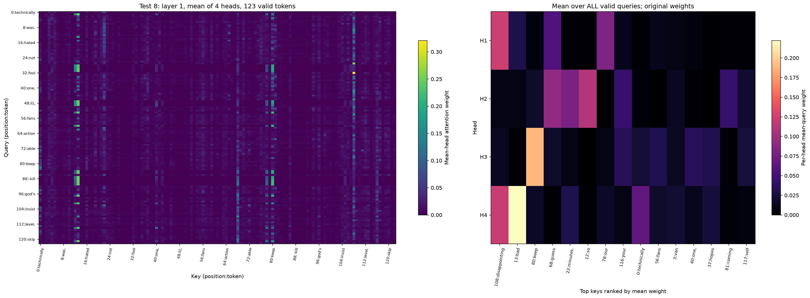
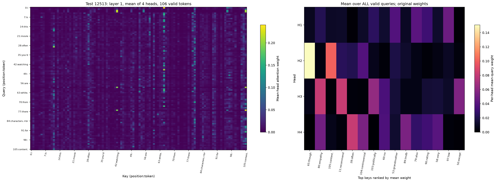
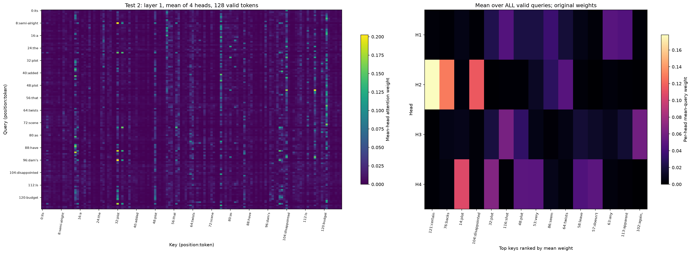
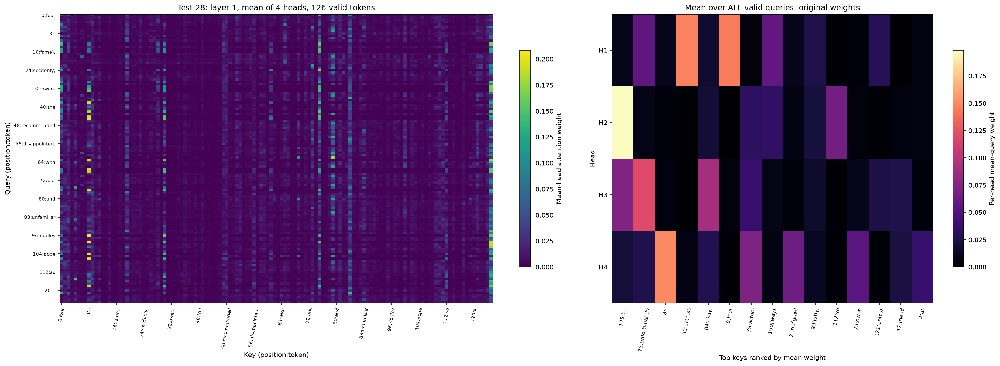
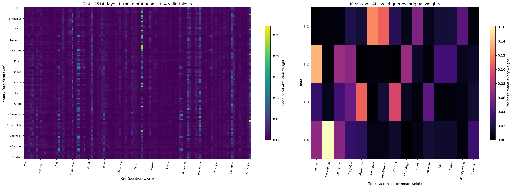
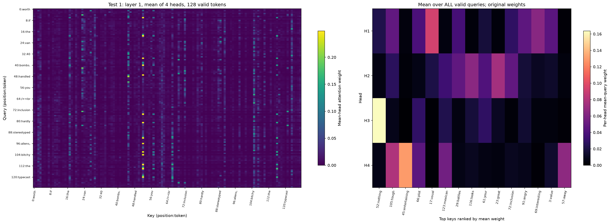

# 26. Error analysis

## 1. Nguồn dữ liệu, checkpoint và cách chọn mẫu

Phân tích dựa trên lần chạy thực tế, không huấn luyện lại. Dataset: `stanfordnlp/imdb`, tập **test chính thức 25.000 mẫu**. Sample ID trong báo cáo là chỉ số hàng **0-based của test**, không phải chỉ số train/validation. Nhãn thật giữ nguyên: `0=Negative`, `1=Positive`. Vocabulary 10.000 token chỉ xây từ 20.000 train; split 20.000/5.000 của train chính thức tái lập từ LAB 05, seed 42, lưu tại `artifacts/experiments_19_22/data_protocol.json`.

Checkpoint duy nhất: [`artifacts\experiments_19_22\transformer_h4_t128_fac251c06717.pt`](artifacts/experiments_19_22/transformer_h4_t128_fac251c06717.pt). SHA256: `23d8c586aad81b21bd11946239d5abd6f48e6f99b2c8d2f2c92251e07e8f7925`.

Cấu hình: embedding ngẫu nhiên đã học, d_model=128, 4 heads (d_k=32), FFN=512, **một encoder layer** tự triển khai trong `transformer_block.py`, sinusoidal PE, dropout residual 0.1 khi train, Linear(128,2), CrossEntropyLoss. Dùng **masked mean pooling, không có CLS**. Max_length=128: tokenizer `text.lower().split()`, UNK=1, giữ 128 token đầu, right padding PAD=0; PAD bị loại ở attention và pooling. Không tách dấu câu hoặc làm sạch HTML khác với khi train. Khi inference dùng model.eval(), torch.no_grad(), float32 trên NVIDIA GeForce RTX 5060 Ti, softmax trên hai logits. Xác suất báo cáo là xác suất của nhãn dự đoán, không mặc nhiên là độ tin cậy đã hiệu chuẩn.

Huấn luyện checkpoint: seed=42, Adam LR=0.001, batch=64, 3 epochs; 1,478,530 tham số trainable. Không nạp model CLS của bài 25.

Checkpoint được validation chọn ở epoch 3 theo macro F1 cao nhất, hòa thì loss thấp hơn rồi epoch sớm hơn. Tính lại test được **20,272 đúng / 4,728 sai**, accuracy **0.81088**, khớp kết quả bài 19. Không dùng test hoặc các mẫu này để đổi checkpoint/cấu hình.

**Quy tắc chọn mẫu:** riêng trong từng nhóm dự đoán đúng và sai, quét ID tăng dần, không lặp: (1) nhãn thật Negative, không truncation, có `not/no/never` hoặc `n't`; (2) nhãn thật Positive, không truncation, có `but/however/although/though/yet`; (3) dài hơn 128 token và có từ trong danh sách cảm xúc định trước ở phần bị cắt. Danh sách: `good, great, excellent, wonderful, amazing, love, loved, enjoyed, best, bad, awful, terrible, boring, poor, worst, disappointing, disappointed, hate, hated`. Nếu không có ứng viên thì lấy mẫu đầu tiên chưa chọn cùng nhóm và ghi fallback. Cả sáu mẫu lần này thỏa tiêu chí gốc, **không fallback**. Từ khóa chỉ sàng lọc; nhãn hiện tượng phải được đối chiếu ngữ cảnh. Cách chọn có chủ đích tăng đa dạng, không đại diện phân bố lỗi toàn test; tỷ lệ 3/3 trong báo cáo không phải tỷ lệ lỗi mô hình.

**Bằng chứng lưu:** [dự đoán toàn test](artifacts/error_analysis/test_predictions.csv), [văn bản/token/tần suất/xác suất và attention summaries](artifacts/error_analysis/evidence.json), [tensor attention đầy đủ của sáu mẫu](artifacts/error_analysis/attention_layer1.pt). Dự đoán và attention được tính lại từ checkpoint thực tế; báo cáo bài 26 chỉ trình bày trong file này, không thêm mục bài 26 vào notebook.

**Cách đọc attention:** encoder **layer 1**, heads **H1–H4**. Với N token hợp lệ, loại toàn bộ hàng/cột PAD rồi tính `a_h(k) = (1/N) sum_q A[h,q,k]` qua **mọi query hợp lệ**; xếp top-k theo `a(k) = (1/4) sum_h a_h(k)`. Không giả định có query CLS. Đây là trung bình số học các attention weights, không phải đóng góp vào logits. Ảnh trái là N×N trung bình bốn heads, trục lấy nhãn cách quãng; ảnh phải là 4×15 top-key, giữ riêng các heads và chung thang màu trong panel, không renormalize sau chọn top-15. Hai panel dùng colorbar riêng vì mức tổng hợp khác nhau. Mọi thống kê dùng full N token hợp lệ, không chỉ top-15. Trọng số trong báo cáo làm tròn khi hiển thị; tensor gốc được lưu.

**Tần suất:** Counter trên đúng 20.000 train, theo token nguyên dạng sau lower().split(), giữ dấu câu/HTML. “Hiếm” ở đây là tần suất **1–5**; tần suất 0 được ghi “chưa thấy ở train”. UNK là ngoài vocabulary đã cắt ở 10.000 token, có thể vẫn có tần suất >5. Token hiển thị trên ảnh là vị trí/văn bản gốc; nếu UNK thì embedding model nhận là UNK, không phải một embedding riêng của từ đó.

## 2. Bảng tổng quan 6 mẫu

| Nhóm | Test ID | Quy tắc | Nhãn thật | Dự đoán | P(nhãn dự đoán) | P(Positive) | Token gốc → giữ | Truncation |
|---|---:|---|---|---|---:|---:|---|---|
| Đúng | 8 | negation | Negative | Negative | 0.942960 | 0.057040 | 123 → 123 | Không |
| Đúng | 12513 | contrast | Positive | Positive | 0.936606 | 0.936606 | 106 → 106 | Không |
| Đúng | 2 | truncation | Negative | Negative | 0.514701 | 0.485299 | 133 → 128 | Có |
| Sai | 28 | negation | Negative | Positive | 0.532658 | 0.532658 | 126 → 126 | Không |
| Sai | 12514 | contrast | Positive | Negative | 0.552800 | 0.447200 | 114 → 114 | Không |
| Sai | 1 | truncation | Negative | Positive | 0.580980 | 0.580980 | 217 → 128 | Có |

## 3. Phân tích 3 mẫu đúng

### Đúng 1 — IMDb test[8]

**Văn bản gốc đầy đủ (không lược bỏ; giữ cả HTML/lỗi viết):**

```text
Technically I'am a Van Damme Fan, or I was. this movie is so bad that I hated myself for wasting those 90 minutes. Do not let the name Isaac Florentine (Undisputed II) fool you, I had big hopes for this one, depending on what I saw in (Undisputed II), man.. was I wrong ??! all action fans wanted a big comeback for the classic action hero, but i guess we wont be able to see that soon, as our hero keep coming with those (going -to-a-border - far-away-town-and -kill -the-bad-guys- than-comeback- home) movies I mean for God's sake, we are in 2008, and they insist on doing those disappointing movies on every level. Why ??!!! Do your self a favor, skip it.. seriously.
```

**Model behavior:** nhãn thật **Negative**, dự đoán **Negative**, P(dự đoán)=0.942960; P(Negative)=0.942960, P(Positive)=0.057040. Token trước truncation=123, nội dung giữ=123; truncation=Không; bỏ 0 token. Input thực tế là vị trí **0–122**, có 21 vị trí UNK trong input.

**Diễn giải của em:** “so bad”, “hated”, “wasting”, “disappointing” và “skip it” tạo đánh giá tiêu cực rõ; các đoạn này đều nằm trong 123 token nhận vào. “Do not let … fool you” là phủ định mang chức năng cảnh báo; “but … wont be able” đối lập kỳ vọng comeback với thất vọng. Không cần suy từ riêng từ `not` sang nhãn Negative.

**Hiện tượng có bằng chứng:** negation; contrast; thuật ngữ/ngữ cảnh điện ảnh như `action`, `classic action hero`; noise ở `I'am`, `??!!!`, chuỗi gạch nối. `florentine` có tần suất train 2 và là UNK; `isaac` có tần suất 9 nhưng vẫn UNK, nên UNK không đồng nghĩa tần suất ≤5. Không truncation.

**Đối chiếu attention:** `disappointing` và `bad` đứng đầu top-key, phù hợp với từ em xem là giàu cảm xúc. Tuy nhiên một số key trọng số cao khác như `keep` không tự mang nhãn cảm xúc. Dự đoán đúng là bằng chứng hành vi; chưa chứng minh hai từ đầu top là nguyên nhân quyết định.

**Token liên quan do con người chọn và weights thực đo:** `a(k)` là trung bình query và heads theo định nghĩa trên. Token sau truncation không có attention trong lần forward này.

| Vị trí | Token gốc | Trong input? | Tần suất train | UNK | a(k) |
|---:|---|---|---:|---|---:|
| 13 | `bad` | Có | 5431 | Không | 0.065458 |
| 16 | `hated` | Có | 207 | Không | 0.012548 |
| 24 | `not` | Có | 22807 | Không | 0.004355 |
| 108 | `disappointing` | Có | 206 | Không | 0.066358 |
| 120 | `skip` | Có | 223 | Không | 0.009758 |

**Ví dụ hiếm/UNK đã kiểm tra trên train:** `1:i'am`: f_train=0, UNK=có; `28:isaac`: f_train=9, UNK=có; `29:florentine`: f_train=2, UNK=có; `30:(undisputed`: f_train=0, UNK=có.

**Top-6 key theo a(k), sau khi loại PAD:**

| Hạng | Vị trí:token | a(k) |
|---:|---|---:|
| 1 | `108:disappointing` | 0.066358 |
| 2 | `13:bad` | 0.065458 |
| 3 | `80:keep` | 0.057056 |
| 4 | `68:guess` | 0.042131 |
| 5 | `22:minutes.` | 0.029665 |
| 6 | `12:so` | 0.029066 |

**Entropy chuẩn hóa trung bình theo query (H1/H2/H3/H4):** 0.7300 / 0.6857 / 0.7029 / 0.6237. Thấp hơn là phân bố tập trung hơn trong định nghĩa này; không phải thước đo chất lượng giải thích.



### Đúng 2 — IMDb test[12513]

**Văn bản gốc đầy đủ (không lược bỏ; giữ cả HTML/lỗi viết):**

```text
I admire Deepa Mehta and this movie is a masterpiece. I'd recommend to buy this movie on DVD because it's a movie you might want to watch more often than just once. And trust me, you'd still find little meaningful details after watching it several times.<br /><br />The characters - except for the grandmother perhaps - are all very balanced, no black and white. Even though you follow the story from the perspective of the two protagonists, there is also empathy for the other characters.<br /><br />I think the IMDb rating for the movie is far too low - probably due to its politically controversial content.
```

**Model behavior:** nhãn thật **Positive**, dự đoán **Positive**, P(dự đoán)=0.936606; P(Negative)=0.063394, P(Positive)=0.936606. Token trước truncation=106, nội dung giữ=106; truncation=Không; bỏ 0 token. Input thực tế là vị trí **0–105**, có 4 vị trí UNK trong input.

**Diễn giải của em:** review khen “admire”, “masterpiece”, “recommend”, “meaningful details”, “empathy”. “Even though … there is also empathy” thể hiện nhượng bộ; “rating … too low” phê bình điểm IMDb, không phải trực tiếp chê phim. “no black and white” mô tả nhân vật không đơn giản hai cực, không phải cảm xúc Negative chỉ vì có `no`. Tất cả những đoạn này còn trong input.

**Hiện tượng có bằng chứng:** contrast/nhượng bộ; phủ định theo ngữ cảnh; tên riêng hiếm `deepa` (train=1, UNK) và `mehta` (train=0, UNK); noise HTML `times.<br`, `/><br`; từ vựng điện ảnh `characters`, `protagonists,`, `rating`. Không truncation.

**Đối chiếu attention:** `though`, `empathy`, `recommend` có trọng số cao, nhưng `masterpiece.` không cần đứng đầu attention để dự đoán đúng. Không suy ra head nào chuyên trách cú pháp hoặc ngữ nghĩa từ ví dụ này.

**Token liên quan do con người chọn và weights thực đo:** `a(k)` là trung bình query và heads theo định nghĩa trên. Token sau truncation không có attention trong lần forward này.

| Vị trí | Token gốc | Trong input? | Tần suất train | UNK | a(k) |
|---:|---|---|---:|---|---:|
| 1 | `admire` | Có | 93 | Không | 0.012032 |
| 9 | `masterpiece.` | Có | 96 | Không | 0.005854 |
| 11 | `recommend` | Có | 1290 | Không | 0.030030 |
| 65 | `though` | Có | 2477 | Không | 0.041880 |
| 80 | `empathy` | Có | 43 | Không | 0.039582 |
| 97 | `low` | Có | 907 | Không | 0.018353 |

**Ví dụ hiếm/UNK đã kiểm tra trên train:** `2:deepa`: f_train=1, UNK=có; `3:mehta`: f_train=0, UNK=có; `59:balanced,`: f_train=4, UNK=có; `76:protagonists,`: f_train=15, UNK=có.

**Top-6 key theo a(k), sau khi loại PAD:**

| Hạng | Vị trí:token | a(k) |
|---:|---|---:|
| 1 | `65:though` | 0.041880 |
| 2 | `80:empathy` | 0.039582 |
| 3 | `105:content.` | 0.030134 |
| 4 | `11:recommend` | 0.030030 |
| 5 | `28:often` | 0.027209 |
| 6 | `104:controversial` | 0.026542 |

**Entropy chuẩn hóa trung bình theo query (H1/H2/H3/H4):** 0.8133 / 0.7212 / 0.7418 / 0.7538. Thấp hơn là phân bố tập trung hơn trong định nghĩa này; không phải thước đo chất lượng giải thích.



### Đúng 3 — IMDb test[2]

**Văn bản gốc đầy đủ (không lược bỏ; giữ cả HTML/lỗi viết):**

```text
its a totally average film with a few semi-alright action sequences that make the plot seem a little better and remind the viewer of the classic van dam films. parts of the plot don't make sense and seem to be added in to use up time. the end plot is that of a very basic type that doesn't leave the viewer guessing and any twists are obvious from the beginning. the end scene with the flask backs don't make sense as they are added in and seem to have little relevance to the history of van dam's character. not really worth watching again, bit disappointed in the end production, even though it is apparent it was shot on a low budget certain shots and sections in the film are of poor directed quality
```

**Model behavior:** nhãn thật **Negative**, dự đoán **Negative**, P(dự đoán)=0.514701; P(Negative)=0.514701, P(Positive)=0.485299. Token trước truncation=133, nội dung giữ=128; truncation=Có; bỏ 5 token. Input thực tế là vị trí **0–127**, có 6 vị trí UNK trong input.

**Diễn giải của em:** “totally average”, “don't make sense”, “not really worth watching again”, “disappointed” làm nhận xét nghiêng tiêu cực dù có lời khen nhẹ ở đầu. `don't` (33,77), `doesn't` (57), `not` (98) và cụm `even though` (109–110) đều còn trong input. Đoạn “poor directed quality” ở 130–132 bị cắt; model không nhận phần đó.

**Hiện tượng có bằng chứng:** long sequence vượt giới hạn 128; truncation 5 token (128–132); negation; contrast; UNK `semi-alright`, `flask` đều chưa xuất hiện trong train. Cụm “flask backs” có vẻ là lỗi viết của một thuật ngữ điện ảnh, nhưng đó là diễn giải, không tự sửa văn bản hoặc tokenizer.

**Đối chiếu attention:** `disappointed` xuất hiện trong top-key, trong khi `certain` và `backs` còn cao hơn. Dự đoán Negative chỉ đạt xác suất khoảng 0.515, gần ranh giới. Giả thuyết: việc bỏ phần chê ở cuối có thể làm mất tín hiệu; chưa thử phản thực nên chưa chứng minh truncation gây ra mức xác suất này. Đây vẫn là mẫu đúng dù đã truncation.

**Token liên quan do con người chọn và weights thực đo:** `a(k)` là trung bình query và heads theo định nghĩa trên. Token sau truncation không có attention trong lần forward này.

| Vị trí | Token gốc | Trong input? | Tần suất train | UNK | a(k) |
|---:|---|---|---:|---|---:|
| 33 | `don't` | Có | 6243 | Không | 0.003081 |
| 57 | `doesn't` | Có | 3480 | Không | 0.016608 |
| 98 | `not` | Có | 22807 | Không | 0.007492 |
| 104 | `disappointed` | Có | 357 | Không | 0.030902 |
| 130 | `poor` | Không | 1224 | Không | — (đã cắt) |

**Ví dụ hiếm/UNK đã kiểm tra trên train:** `8:semi-alright`: f_train=0, UNK=có; `27:dam`: f_train=22, UNK=có; `75:flask`: f_train=0, UNK=có; `90:relevance`: f_train=26, UNK=có.

**Top-6 key theo a(k), sau khi loại PAD:**

| Hạng | Vị trí:token | a(k) |
|---:|---|---:|
| 1 | `121:certain` | 0.045916 |
| 2 | `76:backs` | 0.035625 |
| 3 | `14:plot` | 0.031673 |
| 4 | `104:disappointed` | 0.030902 |
| 5 | `32:plot` | 0.028461 |
| 6 | `116:shot` | 0.028172 |

**Entropy chuẩn hóa trung bình theo query (H1/H2/H3/H4):** 0.7761 / 0.6129 / 0.8018 / 0.7032. Thấp hơn là phân bố tập trung hơn trong định nghĩa này; không phải thước đo chất lượng giải thích.




## 4. Phân tích 3 mẫu sai

### Sai 1 — IMDb test[28]

**Văn bản gốc đầy đủ (không lược bỏ; giữ cả HTML/lỗi viết):**

```text
Four things intrigued me as to this film - firstly, it stars Carly Pope (of "Popular" fame), who is always a pleasure to watch. Secdonly, it features brilliant New Zealand actress Rena Owen. Thirdly, it is filmed in association with the New Zealand Film Commission. Fourthly, a friend recommended it to me. However, I was utterly disappointed. The whole storyline is absurd and complicated, with very little resolution. Pope's acting is fine, but Owen is unfortunately under-used. The other actors and actresses are all okay, but I am unfamiliar with them all. Aside from the nice riddles which are littered throughout the movie (and Pope and Owen), this film isn't very good. So the moral of the story is...don't watch it unless you really want to.
```

**Model behavior:** nhãn thật **Negative**, dự đoán **Positive**, P(dự đoán)=0.532658; P(Negative)=0.467342, P(Positive)=0.532658. Token trước truncation=126, nội dung giữ=126; truncation=Không; bỏ 0 token. Input thực tế là vị trí **0–125**, có 22 vị trí UNK trong input.

**Diễn giải của em:** đầu bài chứa lời khen “pleasure to watch”, “brilliant” và sự giới thiệu của bạn; sau `However,` là “utterly disappointed”, “storyline is absurd”, rồi “isn't very good” và “don't watch”. Đây là đánh giá pha trộn nhưng kết luận chê phim khá rõ, phù hợp nhãn IMDb Negative. Toàn bộ 126 token đều được model nhận, nên không thể quy lỗi này cho truncation.

**Hiện tượng có bằng chứng:** negation (`isn't`, `is...don't`); contrast (`however,`, `but`); noise lỗi chính tả `Secdonly,` (train=0, UNK) và token gộp `is...don't` (train=1, UNK); tên riêng `carly` (train=3, UNK), `rena` (train=0, UNK). `under-used.` có train=1 và là UNK. UNK làm mất phân biệt từ vựng ở chính những vị trí đó, nhưng chưa chứng minh đây là nguyên nhân lỗi.

**Đối chiếu attention:** top-key là `to.`, tiếp theo `unfortunately`; trên heatmap H2 nổi ở `to.`, H3 ở `unfortunately`, H4 ở dấu `-`. Các từ em xem là quan trọng như `disappointed.` và `isn't` được đối chiếu bên dưới, không nhất thiết có thứ hạng cao. Giả thuyết: cách tổng hợp toàn câu chưa cân bằng đúng lời khen đầu bài với phủ định/kết luận cuối bài. Chưa có ablation nên không kết luận một token hay attention pattern gây dự đoán Positive. Xác suất Positive khoảng 0.533 cũng cho thấy đầu ra gần ranh giới.

**Token liên quan do con người chọn và weights thực đo:** `a(k)` là trung bình query và heads theo định nghĩa trên. Token sau truncation không có attention trong lần forward này.

| Vị trí | Token gốc | Trong input? | Tần suất train | UNK | a(k) |
|---:|---|---|---:|---|---:|
| 21 | `pleasure` | Có | 187 | Không | 0.004497 |
| 27 | `brilliant` | Có | 678 | Không | 0.003905 |
| 56 | `disappointed.` | Có | 237 | Không | 0.011810 |
| 72 | `but` | Có | 31743 | Không | 0.003777 |
| 109 | `isn't` | Có | 2385 | Không | 0.008744 |
| 111 | `good.` | Có | 835 | Không | 0.010636 |
| 118 | `is...don't` | Có | 1 | Có | 0.001510 |

**Ví dụ hiếm/UNK đã kiểm tra trên train:** `12:carly`: f_train=3, UNK=có; `13:pope`: f_train=16, UNK=có; `15:"popular"`: f_train=2, UNK=có; `16:fame),`: f_train=5, UNK=có.

**Top-6 key theo a(k), sau khi loại PAD:**

| Hạng | Vị trí:token | a(k) |
|---:|---|---:|
| 1 | `125:to.` | 0.075562 |
| 2 | `75:unfortunately` | 0.052945 |
| 3 | `8:-` | 0.042290 |
| 4 | `30:actress` | 0.039629 |
| 5 | `84:okay,` | 0.039165 |
| 6 | `0:four` | 0.038119 |

**Entropy chuẩn hóa trung bình theo query (H1/H2/H3/H4):** 0.6552 / 0.6517 / 0.7024 / 0.6604. Thấp hơn là phân bố tập trung hơn trong định nghĩa này; không phải thước đo chất lượng giải thích.



### Sai 2 — IMDb test[12514]

**Văn bản gốc đầy đủ (không lược bỏ; giữ cả HTML/lỗi viết):**

```text
This was a bold movie to hit Indian cinemas when it was released. The first movie to perhaps openly depict lesbian tendencies amongst Indian women. The leading actress of Indian cinema Shabana Azmi added substance to the movie with her hot passionate scenes with Nandita Das.<br /><br />The movie oozed with sexuality and the director used sex in the best way possible. The sex was not for erotic purposes but was in the context of the movie. The scene where Nandita Das loses her virginity to her husband certainly was the first of its kind in Indian cinemas.<br /><br />Good acting by all the actors especially Nandita Das amidst criticism from the Indian public
```

**Model behavior:** nhãn thật **Positive**, dự đoán **Negative**, P(dự đoán)=0.552800; P(Negative)=0.552800, P(Positive)=0.447200. Token trước truncation=114, nội dung giữ=114; truncation=Không; bỏ 0 token. Input thực tế là vị trí **0–113**, có 13 vị trí UNK trong input.

**Diễn giải của em:** “bold movie”, “added substance”, “best way possible”, “Good acting” là lời khen. Cấu trúc “not for erotic purposes but … in the context” bác bỏ một cách hiểu về cảnh phim, không trực tiếp đánh giá phim là dở. `criticism from the Indian public` mô tả phản ứng của công chúng; không nhất thiết là thái độ người viết. Nhãn IMDb của mẫu là Positive; không tự đổi nhãn dựa trên chủ đề.

**Hiện tượng có bằng chứng:** negation và contrast; tên riêng hiếm `shabana`/`azmi` (mỗi token train=4, UNK), `nandita` (train=2, UNK); ngữ cảnh điện ảnh `cinema`, `director`, `acting`; noise HTML khiến từ thành token `/>good` ở 99. Không truncation: đủ 114 token nằm trong input.

**Đối chiếu attention:** `best` đứng đầu top-key nhưng model vẫn dự đoán Negative. Điều này trực tiếp nhắc rằng attention cao ở một từ tích cực không bảo đảm nhãn Positive. Giả thuyết: nhiều tên riêng UNK và cấu trúc phủ định/ngữ cảnh chủ đề có thể làm representation khó tổng hợp; chưa kiểm chứng model dựa vào chủ đề hay bất kỳ từ cụ thể nào. Xác suất Negative khoảng 0.553, không phải bằng chứng về sự chắc chắn đã hiệu chuẩn.

**Token liên quan do con người chọn và weights thực đo:** `a(k)` là trung bình query và heads theo định nghĩa trên. Token sau truncation không có attention trong lần forward này.

| Vị trí | Token gốc | Trong input? | Tần suất train | UNK | a(k) |
|---:|---|---|---:|---|---:|
| 3 | `bold` | Có | 60 | Không | 0.013005 |
| 59 | `best` | Có | 4297 | Không | 0.058586 |
| 65 | `not` | Có | 22807 | Không | 0.005482 |
| 69 | `but` | Có | 31743 | Không | 0.005076 |
| 99 | `/>good` | Có | 39 | Không | 0.002484 |
| 109 | `criticism` | Có | 101 | Không | 0.004067 |

**Ví dụ hiếm/UNK đã kiểm tra trên train:** `21:tendencies`: f_train=9, UNK=có; `31:shabana`: f_train=4, UNK=có; `32:azmi`: f_train=4, UNK=có; `44:nandita`: f_train=2, UNK=có.

**Top-6 key theo a(k), sau khi loại PAD:**

| Hạng | Vị trí:token | a(k) |
|---:|---|---:|
| 1 | `59:best` | 0.058586 |
| 2 | `88:certainly` | 0.043990 |
| 3 | `104:actors` | 0.043192 |
| 4 | `113:public` | 0.041042 |
| 5 | `24:women.` | 0.038107 |
| 6 | `27:actress` | 0.033790 |

**Entropy chuẩn hóa trung bình theo query (H1/H2/H3/H4):** 0.7356 / 0.6475 / 0.7368 / 0.6810. Thấp hơn là phân bố tập trung hơn trong định nghĩa này; không phải thước đo chất lượng giải thích.



### Sai 3 — IMDb test[1]

**Văn bản gốc đầy đủ (không lược bỏ; giữ cả HTML/lỗi viết):**

```text
Worth the entertainment value of a rental, especially if you like action movies. This one features the usual car chases, fights with the great Van Damme kick style, shooting battles with the 40 shell load shotgun, and even terrorist style bombs. All of this is entertaining and competently handled but there is nothing that really blows you away if you've seen your share before.<br /><br />The plot is made interesting by the inclusion of a rabbit, which is clever but hardly profound. Many of the characters are heavily stereotyped -- the angry veterans, the terrified illegal aliens, the crooked cops, the indifferent feds, the bitchy tough lady station head, the crooked politician, the fat federale who looks like he was typecast as the Mexican in a Hollywood movie from the 1940s. All passably acted but again nothing special.<br /><br />I thought the main villains were pretty well done and fairly well acted. By the end of the movie you certainly knew who the good guys were and weren't. There was an emotional lift as the really bad ones got their just deserts. Very simplistic, but then you weren't expecting Hamlet, right? The only thing I found really annoying was the constant cuts to VDs daughter during the last fight scene.<br /><br />Not bad. Not good. Passable 4.
```

**Model behavior:** nhãn thật **Negative**, dự đoán **Positive**, P(dự đoán)=0.580980; P(Negative)=0.419020, P(Positive)=0.580980. Token trước truncation=217, nội dung giữ=128; truncation=Có; bỏ 89 token. Input thực tế là vị trí **0–127**, có 14 vị trí UNK trong input.

**Diễn giải của em:** phần đầu vừa khen “entertaining”, “great”, “clever” vừa chê “nothing … blows you away”, “hardly profound”, “heavily stereotyped”. Cuối bản gốc có “Not bad. Not good. Passable 4.”, một kết luận pha trộn và điểm số thấp; giữ nguyên nhãn Negative của dataset, không áp đặt một “đáp án” cảm xúc tuyệt đối bằng suy diễn cá nhân.

**Hiện tượng có bằng chứng:** long sequence 217 token; truncation bỏ 89 token từ vị trí 128; contrast `but` ở 49/79 còn được nhận; `hardly` ở 80 cũng còn trong input. Kết luận `/>not bad. not good. passable 4.` ở 211–216 bị cắt hoàn toàn. Có thuật ngữ điện ảnh/hành động như `car chases,`, `shotgun,`, `plot` và noise HTML. `shotgun,` (train=3), `feds,` (train=1), `federale` (train=1) là token hiếm và UNK trong input; không gắn attention cho các token ngoài 0–127.

**Đối chiếu attention:** `nothing` đứng đầu; `entertaining` cũng thuộc top-key, cho thấy cả dấu hiệu chê và khen xuất hiện trong phần input có weights đo được. Giả thuyết: đoạn kết bị cắt và cảm xúc pha trộn có thể góp phần gây lỗi Positive. Không thể kết luận việc giữ đoạn kết chắc chắn đổi nhãn nếu chưa chạy thử có kiểm soát; không nói model “chú ý” hay “bỏ qua” câu kết mà nó chưa nhận.

**Token liên quan do con người chọn và weights thực đo:** `a(k)` là trung bình query và heads theo định nghĩa trên. Token sau truncation không có attention trong lần forward này.

| Vị trí | Token gốc | Trong input? | Tần suất train | UNK | a(k) |
|---:|---|---|---:|---|---:|
| 23 | `great` | Có | 6130 | Không | 0.023172 |
| 45 | `entertaining` | Có | 793 | Không | 0.034394 |
| 49 | `but` | Có | 31743 | Không | 0.005660 |
| 52 | `nothing` | Có | 3017 | Không | 0.049848 |
| 78 | `clever` | Có | 337 | Không | 0.012715 |
| 211 | `/>not` | Không | 172 | Không | — (đã cắt) |
| 213 | `not` | Không | 22807 | Không | — (đã cắt) |
| 215 | `passable` | Không | 38 | Không | — (đã cắt) |

**Ví dụ hiếm/UNK đã kiểm tra trên train:** `6:rental,`: f_train=9, UNK=có; `19:chases,`: f_train=29, UNK=có; `35:shotgun,`: f_train=3, UNK=có; `40:bombs.`: f_train=4, UNK=có.

**Top-6 key theo a(k), sau khi loại PAD:**

| Hạng | Vị trí:token | a(k) |
|---:|---|---:|
| 1 | `52:nothing` | 0.049848 |
| 2 | `105:tough` | 0.040494 |
| 3 | `45:entertaining` | 0.034394 |
| 4 | `66:plot` | 0.030324 |
| 5 | `17:usual` | 0.029348 |
| 6 | `123:mexican` | 0.028894 |

**Entropy chuẩn hóa trung bình theo query (H1/H2/H3/H4):** 0.7303 / 0.6881 / 0.7035 / 0.6858. Thấp hơn là phân bố tập trung hơn trong định nghĩa này; không phải thước đo chất lượng giải thích.



## 5. Nhận xét chung và giới hạn

**Hành vi đo được:** model đúng ở cả mẫu tiêu cực rõ (8), lời khen có nhượng bộ (12513) và một mẫu đã truncation (2). Ba mẫu sai có xác suất nhãn dự đoán khoảng 0.533, 0.553 và 0.581, đều gần ranh giới hơn hai mẫu đúng đầu tiên. Không lấy sáu mẫu này để kết luận model luôn tự tin hay đánh giá calibration. Nhãn/xác suất và các bảng token là bằng chứng; những nhận định dưới đây về cơ chế gây lỗi chỉ là giả thuyết.

**Hiện tượng gây khó khăn:** negation/contrast xuất hiện trong cả nhóm đúng và sai, nên có từ “not” hay “but” không đủ giải thích kết quả. Mẫu 28 có lời khen ban đầu nhưng kết luận chê, còn mẫu 12514 dùng phủ định để phân biệt mục đích của cảnh phim; lỗi có thể liên quan đến việc tổng hợp cảm xúc theo ngữ cảnh. Hai mẫu sai này không truncation, vì vậy không thể đổ tất cả lỗi cho giới hạn chiều dài. Mẫu 1 bị mất kết luận cuối, còn mẫu 2 vẫn đúng khi mất năm token; cần ablation giữ/bỏ ngữ cảnh cuối để kiểm tra ảnh hưởng thực sự.

**Từ hiếm, domain và noise:** tên riêng, từ có dấu câu/HTML và lỗi viết tạo nhiều UNK theo tokenizer đơn giản hiện có. Đã có chứng cứ tần suất train và trạng thái UNK, nhưng chưa can thiệp tokenizer hay embedding để chứng minh đó là nguyên nhân lỗi. Các cụm như “plot”, “director”, “acting”, “action hero” là ngữ cảnh điện ảnh; chúng không tự là nhãn cảm xúc. Cảm xúc pha trộn cần đọc cả phạm vi phủ định và đối lập, không áp đặt một nhãn đúng tuyệt đối bằng vài từ khóa; nhãn dataset vẫn được giữ nguyên để xác định đúng/sai.

**Attention patterns:** trọng số cao có thể nằm ở từ cảm xúc (`bad`, `disappointing`, `best`) hoặc từ không tự mang polarity (`to.`, `certain`). Mẫu 12514 có `best` đứng đầu nhưng dự đoán Negative; mẫu 28 có H2 tập trung ở `to.` và H3 ở `unfortunately`, minh họa rằng heads có phân bố khác nhau. Việc gộp query/heads có thể che tương tác cục bộ; top-key chỉ tóm tắt weights, không phản ánh toàn bộ Q/K/V, output projection, residual, FFN, LayerNorm và classifier.

**Không kết luận “Attention = explanation”.** Attention visualization chỉ biểu diễn phân phối attention weights. Token có attention cao chưa được chứng minh là nguyên nhân quyết định dự đoán; attention thấp cũng chưa đủ chứng minh token không ảnh hưởng kết quả. Không có weights cho phần bị cắt hoặc PAD trong các hình/thống kê này. Muốn kiểm tra quan hệ nhân quả cần can thiệp có kiểm soát (ví dụ masking/thay token, giữ ngữ cảnh cuối), ngoài phạm vi lần phân tích này. Chỉ một checkpoint, một seed và sáu mẫu chọn có chủ đích; chưa thể suy rộng nguyên nhân hay tỷ lệ lỗi của từng hiện tượng trên toàn dataset.

## 6. Learning curves và confusion matrix (phần ngoài phạm vi giữ lại)

TODO: phân tích overfitting, underfitting, convergence, instability và các nhóm lỗi.
