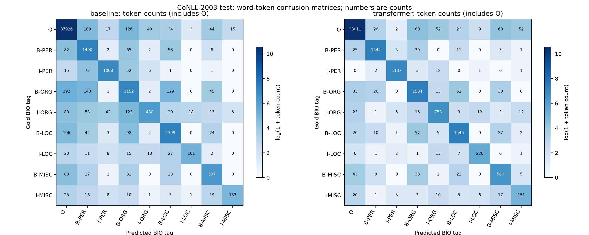
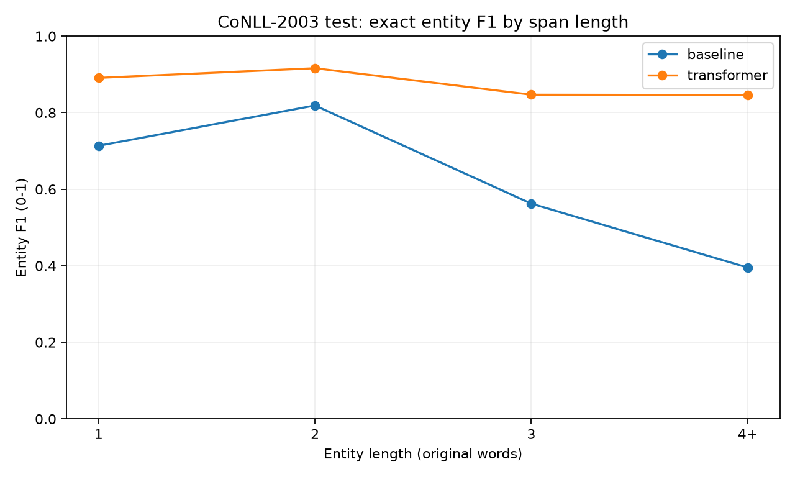

# LAB 09: Named Entity Recognition and Information Extraction

<a id="lab09-section-1"></a>
## 1. Vai trò của LAB 09


Bài thực hành triển khai baseline token features + Logistic Regression và fine-tuning DistilBERT trên toàn bộ CoNLL-2003; đánh giá exact entity, phân tích tokenization/lỗi và trích xuất JSON theo Option A. Code, đáp án và báo cáo có nội dung đầy đủ. Các kết quả dưới đây được sinh từ thực nghiệm thật; không tự khẳng định số điểm chấm.

### Môi trường, dependencies và cài đặt


Runtime được người dùng cho phép tại **`C:/Users/tasdus_117/Desktop/NLP_runtime/lab09`**. Môi trường cũ đã được chuyển nguyên, không xóa checkpoint hoặc tải/train lại để thay thế. SHA256 từng file khớp trước/sau move; kernelspec cập nhật interpreter ở đích. `.venv` kế thừa system-site-packages đã có; không cài hoặc sửa Python hệ thống. Đã chạy phép tính CUDA thật trên RTX5060Ti16GB, PyTorch2.14.0+cu132, Python3.12.0/Windows.

Dependencies đã dùng: torch2.14.0+cu132, transformers5.22.2, tokenizers0.23.3, scikit-learn1.9.1, numpy2.5.2, scipy1.18.1, pandas3.0.6, pyarrow26.0.0, matplotlib3.11.2, requests2.34.2, joblib1.6.0, nbformat5.11.1, nbclient0.11.0, ipykernel7.3.0, tabulate0.10.0; Pillow để kiểm tra PNG. Phiên bản cốt lõi còn được ghi trong manifest training và output notebook.

```powershell
cd C:/Users/tasdus_117/Desktop/NLP/lab09
$env:LAB09_RUNTIME = 'C:/Users/tasdus_117/Desktop/NLP_runtime/lab09'
$env:PYTHONDONTWRITEBYTECODE = '1'
$py = Join-Path $env:LAB09_RUNTIME '.venv/Scripts/python.exe'
# Chỉ tạo môi trường nếu chưa có; môi trường hiện tại dùng ngay được.
if (-not (Test-Path -LiteralPath $py)) {
    python -m venv "$env:LAB09_RUNTIME/.venv"
    & $py -m pip install torch==2.14.0
    & $py -m pip install transformers==5.22.2 tokenizers==0.23.3 scikit-learn==1.9.1 numpy==2.5.2 scipy==1.18.1 pandas==3.0.6 pyarrow==26.0.0 matplotlib==3.11.2 requests==2.34.2 joblib==1.6.0 nbformat==5.11.1 nbclient==0.11.0 ipykernel==7.3.0 tabulate==0.10.0 pillow
}
& $py -B -c "import torch; print(torch.__version__, torch.cuda.is_available())"
```

Lệnh pin dependencies mô tả môi trường đã chạy; chưa thử cài sạch trên máy khác. Với GPU khác, chọn wheel phù hợp theo [hướng dẫn chính thức PyTorch](https://pytorch.org/get-started/locally/). Máy hiện tại đã có CUDA wheel hoạt động; không cần cài lại. CPU dùng float32 tự động nhưng chưa đo full training CPU. Không sử dụng dịch vụ trả phí.

### Runtime paths và thứ tự chạy


`LAB09_RUNTIME` mặc định là đường dẫn đã cho phép ở trên; code từ chối runtime nằm trong lab09. `sys.dont_write_bytecode=True` và `-B` ngăn tạo `__pycache__`; Jupyter/IPython/matplotlib cache nằm trong runtime. Không train khi import module.

| Thành phần runtime | Đường dẫn tương đối với LAB09_RUNTIME |
|---|---|
| Dataset pinned | `.cache/data/conll2003/{train,validation,test}/0000.parquet` |
| Backbone pretrained | `.cache/backbone/` |
| Python | `.venv/Scripts/python.exe` |
| Checkpoint NER + tokenizer/config | `artifacts/checkpoint/` |
| Baseline được chọn bằng validation | `artifacts/baseline.joblib` |
| Full gold/predictions | `artifacts/{baseline,transformer}_{validation,test}_predictions.jsonl` |
| History/cấu hình/thống kê/logs/IE30 | `artifacts/` |
| Kernelspec cho runner | `jupyter/kernels/lab09/kernel.json` |
| Baseline C1 trước bổ sung validation search | `artifacts/baseline_before_validation_selection/` |
| Bản phục hồi trước chỉnh sửa cuối | `artifacts/submission_before_finalization/`, `artifacts/pre_consolidation_sources.json` |

Từ trạng thái sạch, chạy tuần tự:

```powershell
& $py -B baseline_ner.py prepare       # tải file pinned và kiểm tra SHA256
& $py -B baseline_ner.py checks        # 11 self-checks nhỏ
& $py -B baseline_ner.py notebooks --train
# Lệnh trên chạy alignment rồi train baseline/Transformer, chọn bằng validation,
# evaluate test, sinh CSV/PNG/báo cáo và chạy verifier sau khi lưu notebook.
```

Với runtime và checkpoint hiện có, lệnh đã dùng để kiểm tra phiên bản cuối mà không retrain Transformer:

```powershell
& $py -B baseline_ner.py train         # baseline C grid, validation selection rồi test
& $py -B baseline_ner.py notebooks     # hai kernel sạch; đọc checkpoint/history thật
& $py -B baseline_ner.py verify        # kiểm tra độc lập sau khi notebooks đã lưu
& $py -B information_extraction.py --evaluate --text 'Barack Obama visited Paris.'
```

`LAB09_TRAIN=0` mặc định đọc checkpoint/history hiện có; `--train` đặt `LAB09_TRAIN=1` để tạo một lượt fine-tuning mới. Có thể chọn kernel runtime trong trình soạn thảo để chạy từng notebook từ trên xuống. Không chạy đồng thời nhiều training vào cùng runtime vì dùng chung output. Runner tạo kernelspec ngoài lab09, không cần module hay requirements file phụ trong bài nộp.

<a id="lab09-section-3"></a>
## 3. Dataset: CONLL-2003


- [CoNLL-2003 trên Hugging Face](https://huggingface.co/datasets/eriktks/conll2003), repo `eriktks/conll2003`, Parquet revision `ce85b39f9dd99f552d0739d456814e95fb6a39b0` của nhánh convert/parquet. Downloader chỉ đọc Parquet, không thực thi remote dataset script. URL/bytes/SHA256 từng file được pin trong `baseline_ner.SOURCE_MANIFEST`, giữ cả trong snapshot notebook và manifest runtime. Tham khảo điều kiện dataset card trước phân phối lại.
- [DistilBERT base cased](https://huggingface.co/distilbert/distilbert-base-cased), revision `6ea81172465e8b0ad3fddeed32b986cdcdcffcf0`, pretrained ngôn ngữ. Token-classification head mới được khởi tạo và fine-tune cùng backbone; không dùng checkpoint NER fine-tuned sẵn thay cho training.
- Alignment/token head theo [API token classification](https://huggingface.co/docs/transformers/tasks/token_classification), nhưng core được thực hiện trực tiếp bằng tokenizer, word_ids, forward/backward, không dùng pipeline NER.

| Split chính thức | Câu | Words |
|---|---:|---:|
| train |14041|203621|
| validation |3250|51362|
| test |3453|46435|

Mapping metadata: O, B/I-PER, B/I-ORG, B/I-LOC, B/I-MISC. Kiểm tra thực tế thấy bản này là IOB2,0 gold labels cần đổi ở cả3 splits. Code vẫn chuyển I-X sau O/type khác thành B-X công khai cho cả gold/predictions trước scoring. <a id="lab09-section-12"></a>
## 12. Prediction Before Experiment


Ba prediction có lý do/phép đo được ghi trước thực nghiệm đầu tiên, giữ nguyên các câu dự đoán trong [prediction.md](prediction.md). Nội dung ba câu được fingerprint độc lập với tiêu đề biên tập. Bản file ban đầu và hash trước chạy còn trong runtime/history; không viết lại hướng dự đoán để khớp kết quả.

<a id="lab09-section-13"></a>
## 13. Baseline

Baseline dùng word/lower, prefix/suffix, casing/digits và context±1 trong cùng câu. DictVectorizer và Logistic Regression chỉ fit train. Khi hoàn thiện yêu cầu chọn cấu hình bằng validation, grid **C={0.5,1,2} được cố định trước lượt chạy mới**, tie chọn C nhỏ hơn; không dùng test để chọn. Baseline C1 cũ (test F1 .730076) được giữ riêng, không trộn thành kết quả cấu hình hiện tại.

|        C |   precision |   recall |       f1 |     support |          tp |          fp |          fn |
|---------:|------------:|---------:|---------:|------------:|------------:|------------:|------------:|
| 0.500000 |    0.811808 | 0.826153 | 0.818917 | 5942.000000 | 4909.000000 | 1138.000000 | 1033.000000 |
| 1.000000 |    0.822889 | 0.839785 | 0.831251 | 5942.000000 | 4990.000000 | 1074.000000 |  952.000000 |
| 2.000000 |    0.831135 | 0.848199 | 0.839580 | 5942.000000 | 5040.000000 | 1024.000000 |  902.000000 |

Chọn C=2 theo validation F1 cao nhất, hội tụ46iterations và không ConvergenceWarning. Sau lựa chọn mới chạy test. Thời gian baseline hiện tại17.696662s gồm feature extraction, train3candidates, validation và save; không gồm lượt test cuối. Đây không phải so sánh tốc độ công bằng với một mô hình đơn lẻ.

<a id="lab09-section-14"></a>
## 14. Transformer Token Classification

Transformer: seed42, toàn bộ14041câu train, batch32,3epochs, AdamW lr5e-5/wd0.01, warmup131steps (10%) rồi linear decay, clipping1.0, max_length256, padding động, CUDA fp16/GradScaler. Validation F1 qua epochs .914105→.933255→.942459; chọn epoch3 rồi test. Training+validation+save ghi71.118120s, không gồm download/encoding/test. Checkpoint thật được giữ nguyên khi chuyển runtime; phiên bản cuối kiểm tra lại inference và phân tích, không gắn nhãn thành training mới. Checkpoint SHA256: `4080fe27c905bbcd4ba69fbf004f933eb7b9a4e38877aa887b7bf9baa16c49f0`.

First-subtoken: special/pad/continuation có label -100; continuation attention_mask vẫn1. Chunks chỉ cắt giữa words trọn vẹn, không truncation âm thầm; một word riêng quá giới hạn gây lỗi rõ ràng. Ghép prediction theo word về câu gốc trước BIO/scoring nên không bỏ gold entities qua biên, dù context qua biên bị hạn chế.

<a id="lab09-section-17"></a>
## 17. Experiment 1: Tokenization Analysis


20câu validation đầu <=20words và20câu đầu >20words tạo mẫu40câu,797words→1024subwords,116words split,227mảnh thêm. R ngắn1.6023/dài1.1981, entity1.6036/nonentity1.1990. Tỷ lệ words split entity33.14%/nonentity9.55%, khác với R. Ví dụ LEICESTERSHIRE9mảnh, CRICKET4mảnh. Headline viết hoa trong mẫu ngắn là một yếu tố có thể liên quan; không kết luận câu ngắn nói chung khó tokenizer hơn. Bảng đầy đủ và phép kiểm tra nằm trong [tokenizer_alignment.ipynb](tokenizer_alignment.ipynb).

<a id="lab09-section-18"></a>
## 18. Experiment 2: Baseline vs Transformer


| model       | split   |   sentences |   precision |   recall |       f1 |   support |   tp |   fp |   fn |   seed |   training_seconds |
|:------------|:--------|------------:|------------:|---------:|---------:|----------:|-----:|-----:|-----:|-------:|-------------------:|
| baseline    | test    |        3453 |    0.719953 | 0.755135 | 0.737124 |      5648 | 4265 | 1659 | 1383 |     42 |          17.696662 |
| transformer | test    |        3453 |    0.887674 | 0.905276 | 0.896388 |      5648 | 5113 |  647 |  535 |     42 |          71.118120 |

Transformer tăng F1 khoảng 0.159264 tuyệt đối so với baseline đã chọn bằng validation. Đây là một seed và một corpus, chưa có khoảng tin cậy hoặc kiểm định ưu thế tổng quát.

<a id="lab09-section-19"></a>
## 19. Experiment 3: Entity-Level Evaluation

Metric là exact word-span + type sau chuẩn hóa IOB2, không chấm partial match hoặc bỏ predictions không hợp lệ để làm đẹp F1. Mẫu số0 trả0 và luôn báo support.

### Confusion matrix cấp word-token



Confusion matrix là **word-token BIO**, hàng gold/cột prediction, gồm O. Số trong ô là word counts; màu log(1+count). Entity tag→O là missed token, O→entity tag là spurious token; không đồng nhất với FN/FP entity. Mỗi model có tổng46435words. CSV/PNG do cell phân tích sinh từ full predictions, không nhập tay.

<a id="lab09-section-21"></a>
## 21. Experiment 4: Entity Type Analysis


| model       | type   |   training_support |   precision |   recall |       f1 |   support |   tp |   fp |   fn |
|:------------|:-------|-------------------:|------------:|---------:|---------:|----------:|-----:|-----:|-----:|
| baseline    | PER    |               6600 |    0.710315 | 0.821892 | 0.762041 |      1617 | 1329 |  542 |  288 |
| baseline    | ORG    |               6321 |    0.623049 | 0.624925 | 0.623986 |      1661 | 1038 |  628 |  623 |
| baseline    | LOC    |               7140 |    0.809327 | 0.821942 | 0.815586 |      1668 | 1371 |  323 |  297 |
| baseline    | MISC   |               3438 |    0.760462 | 0.750712 | 0.755556 |       702 |  527 |  166 |  175 |
| transformer | PER    |               6600 |    0.949907 | 0.949907 | 0.949907 |      1617 | 1536 |   81 |   81 |
| transformer | ORG    |               6321 |    0.849885 | 0.886213 | 0.867669 |      1661 | 1472 |  260 |  189 |
| transformer | LOC    |               7140 |    0.919952 | 0.923261 | 0.921604 |      1668 | 1540 |  134 |  128 |
| transformer | MISC   |               3438 |    0.766621 | 0.804843 | 0.785268 |       702 |  565 |  172 |  137 |

PER có title-case fraction train0.9588 và Transformer F1 cao nhất; MISC có support thấp nhất3438 và Transformer F1 thấp nhất. Tuy nhiên baseline ORG kém MISC dù support ORG cao hơn: support đơn thuần không giải thích đủ performance. Các giả thuyết lexical patterns, ambiguity và boundary được đối chiếu với lỗi cụ thể trong [error_analysis.md](error_analysis.md), không khẳng định cơ chế nội bộ model khi thiếu bằng chứng.

<a id="lab09-section-22"></a>
## 22. Experiment 5: Entity Length


| model       | length   |   precision |   recall |       f1 |   support |   tp |   fp |   fn |
|:------------|:---------|------------:|---------:|---------:|----------:|-----:|-----:|-----:|
| baseline    | 1        |    0.664975 | 0.769726 | 0.713526 |      3574 | 2751 | 1386 |  823 |
| baseline    | 2        |    0.857583 | 0.783221 | 0.818717 |      1776 | 1391 |  231 |  385 |
| baseline    | 3        |    0.751773 | 0.449153 | 0.562334 |       236 |  106 |   35 |  130 |
| baseline    | 4+       |    0.708333 | 0.274194 | 0.395349 |        62 |   17 |    7 |   45 |
| transformer | 1        |    0.878639 | 0.903470 | 0.890882 |      3574 | 3229 |  446 |  345 |
| transformer | 2        |    0.916104 | 0.916104 | 0.916104 |      1776 | 1627 |  149 |  149 |
| transformer | 3        |    0.838174 | 0.855932 | 0.846960 |       236 |  202 |   39 |   34 |
| transformer | 4+       |    0.808824 | 0.887097 | 0.846154 |        62 |   55 |   13 |    7 |



Length là số words annotation gốc, không subwords. Gold và predicted spans tự vào bin1/2/3/4+ theo độ dài của chính nó: sai độ dài tạo FP ở predicted bin và FN ở gold bin. Support4+ chỉ62. Nhóm2 tốt hơn nhóm1 ở cả hai model, còn3/4+ kém nhóm1; prediction về độ dài chỉ được hỗ trợ một phần, không có xu hướng giảm đơn điệu.

### Độ hiếm theo training support

Rare = gold surface casefold xuất hiện0–1lần trong train, common>=2; không dùng test để xác định tần suất. Chỉ đo recall exact-match trên gold theo rarity, không gọi là F1:

| model       | group   |   support |   exact_tp |   recall |
|:------------|:--------|----------:|-----------:|---------:|
| baseline    | rare    |      2851 |       1713 | 0.600842 |
| baseline    | common  |      2797 |       2552 | 0.912406 |
| transformer | rare    |      2851 |       2493 | 0.874430 |
| transformer | common  |      2797 |       2620 | 0.936718 |

Rare recall thấp hơn common ở cả hai model, phù hợp hướng dự đoán. Type/length/context có thể gây nhiễu; chưa chứng minh quan hệ nhân quả của độ hiếm.

<a id="lab09-section-23"></a>
## 23. Experiment 6: Error Analysis


[error_analysis.md](error_analysis.md) có5FP,5FN,5boundary errors thực sự cùng type/overlap nhưng lệch span, ghi test ID/text/gold/pred/giải thích cụ thể. Các nhóm có thể trùng; tổng Transformer FP647/FN535,130cặp boundary overlap. Tìm được64 surface forms đa type trong gold test; trích3forms ARIZONA, ATLANTA, American với câu/ID/nhãn đúng. Quan sát được tách khỏi giả thuyết. Dữ liệu train/validation/test cùng corpus Reuters, chưa định lượng domain shift bằng một benchmark ngoài miền.

<a id="lab09-section-25"></a>
## 25. Application: Information Extraction

[Pipeline và JSON](information_extraction.py): `Extractor.extract()`, `raw_words()`, `to_json()`.

<a id="lab09-section-26"></a>
## 26. Mini Information Extraction Task

OptionA dùng JSON gồm `text`, `PERSON`, `ORG`, `LOCATION`, `word_predictions`; mỗi entity `{text,start,end}`, offsets ký tự Python end-exclusive. MISC bỏ ở cả gold/pred khi tính IE. Hai B cùng type kề nhau thành hai entities; thứ tự và raw boundaries được giữ. Regex wordization tách punctuation, giữ apostrophe/hyphen trong word, bỏ standalone Unicode C*/U+FFFD mà tokenizer loại; giữ raw text/offsets, đọc file newline='' để không đổi CRLF. Chunking giống training và giới hạn256subwords được công bố; abbreviations có thể khác CoNLL wordization.

```powershell
& $py -B information_extraction.py --text 'Barack Obama visited Paris.'
& $py -B information_extraction.py --input-file "$env:LAB09_RUNTIME/input.txt" --output "$env:LAB09_RUNTIME/artifacts/extraction_long.json"
& $py -B information_extraction.py --evaluate
```

Ví dụ thực chạy: PERSON=Barack Obama [0,12), LOCATION=Paris [21,26), ORG=[]; file JSON ở runtime/artifacts/extraction.json. <a id="lab09-section-27"></a>
## 27. Evaluation của Information Extraction

IE30 lấy **30câu test đầu cố định trước inference**, gold annotation corpus độc lập với model, nối words một dấu cách rồi project word spans sang character spans. Snapshot trong notebook giữ gold/output cả30câu; script tái tạo hợp lệ từ corpus pinned. Kết quả: TP50,FP3,FN3,support53 sau loại MISC, precision=recall=F1=0.943396. Đây là đánh giá cùng miền và overlap test NER, không phải gold mới human-verified hay kiểm chứng ngoài miền.

<a id="lab09-section-28"></a>
## 28. AI Usage


AI-assisted code:
- What was generated: baseline, alignment/BIO/scorer, training loop/notebooks, plots.
- What was modified: hoàn thiện/gộp các file khung theo cấu trúc13deliverables, chuyển runtime và giữ checkpoint thật.
- What was verified: thực nghiệm full corpus trước đó, baseline validation search mới, hai notebook kernels sạch ở runtime mới,11tests, exact metrics/artifacts/gold/offsets/hashes và các đường dẫn runtime như mô tả trên.

<a id="lab09-section-29"></a>
## 29. Deliverables


```text
lab09/
├── doc/
│   └── lab_09_named_entity_recognition_and_information_extraction.md
├── README.md
├── calculations.md
├── prediction.md
├── baseline_ner.py
├── tokenizer_alignment.ipynb
├── ner_finetuning.ipynb
├── results.csv
├── entity_metrics.csv
├── entity_length_analysis.png
├── confusion_matrix.png
├── error_analysis.md
├── information_extraction.py
└── reflection.md
```

`baseline_ner.py` chứa baseline, loader/downloader pinned, BIO normalization/decoding, exact scorer, alignment, self-checks, verifier và runner notebook. `information_extraction.py` chứa word/chunk inference dùng chung, raw-text offsets, schema và IE evaluation. Training loop, checkpoint selection và code sinh bốn CSV/PNG nằm trực tiếp trong `ner_finetuning.ipynb`. `tokenizer_alignment.ipynb` phân tích40 câu và minh họa alignment. Các file Markdown trả lời đầy đủ phần lý thuyết, prediction, lỗi và reflection.

<a id="lab09-section-30"></a>
## 30. Rubric


Chỉ số cells tính từ0 và gồm Markdown. Trạng thái dưới đây là kiểm chứng kỹ thuật/nội dung, không tự chấm điểm hoặc xác nhận tác giả sinh viên.

| Hạng mục | Điểm | File/cell thực hiện | Bằng chứng |
|---|---:|---|---|
|Theory & calculation|10|calculations.md §4–7,11,15,19–20|BIO Elon/University, shapes8×128×768→9, loss và entity P/R/F1 có giải thích|
|Prediction|10|prediction.md|3prediction gốc có lý do/phép đo, fingerprint, đối chiếu riêng từ số liệu thật|
|BIO & label alignment|15|alignment cells2,6,7,9; baseline_ner.py|metadata IOB2, bảng words/subwords/IDs/mask/word_ids/labels, split/special/pad/truncation asserts|
|Baseline implementation|10|baseline_ner.py train; fine-tuning cell4|train-only vectorizer, validation C grid, saved model, full same-test JSONL/P/R/F1|
|Transformer NER implementation|15|fine-tuning cells2,6,7,9,11|explicit fine-tune code, history3epochs, bestvalcheckpoint, tensors/logits, pinned sources/hyperparameters/device/time|
|Tokenization experiment|10|alignment cell4 và kết luận cuối|40câu thật,4đại lượng/R, short/long/entity/nonentity, ví dụ split|
|Entity-level evaluation|10|fine-tuning cell13; baseline scorer|overall/type/support/length, exact span+type, đúng FP/FN bins, CSV/PNG từ predictions|
|Error analysis|10|error_analysis.md; fine-tuning cell13|5FP/5FN/5boundary,3ambiguous forms, train support/rarity/context/domain|
|Information Extraction|5|information_extraction.py; fine-tuning cell15|raw-text inference/checkpoint/schema/offsets/chunking,30gold corpus và metrics thật|
|Reflection|5|reflection.md|430từ, backbone/head/shapes/labels/loss/fine-tuning;10learning checks riêng|

Tổng phạm vi rubric100điểm. Đề và các lab khác giữ nguyên. Các chức năng cần thiết đã gộp vào2scripts/2notebooks; dependencies/config/tests không cần file phụ trong bài nộp. Tất cả10 nhóm có nội dung thực chất và bằng chứng tương ứng; việc chấm điểm thuộc giảng viên.

### Kiểm chứng và giới hạn thực tế


- 11 self-checks: IOB normalization, exact/wrong boundary/wrong type/missing/spurious, length FP/FN, first-subtoken/split/special/pad, BIO adjacentB, sparse features, Unicode/CRLF offsets, validation selection không dùng test và bảo toàn output notebook khi một lượt rerun gặp lỗi kernel. Runner chỉ lưu notebook sau khi execute thành công.
- Hai notebook chạy từ kernel sạch tại runtime mới:5+11code cells, counters liên tục, không output error. Đã chạy lại core forward, phân tích và IE30; checkpoint Transformer cũ được tái sử dụng hợp lệ, lịch sử training vẫn là số đo thật trước chuyển.
- Verifier tính lại CSV/type/length/confusion từ JSONL, kiểm goldIE từ corpus, errors/ambiguity, source hashes, prediction fingerprint, ảnh PNG, độ dài reflection và hash đề. `artifacts/verification.json` ngoài bài nộp lưu kết quả/hashes; function ở baseline có thể chạy chủ động.
- Đã kiểm inference checkpoint với BOM/zero-width, input rỗng và fixture dài500words; word coverage/offsets khớp. Fixtures là kiểm thử thuật toán, không phải dataset hoặc metrics thực nghiệm. JSON IE được đối chiếu với word predictions/schema.

Giới hạn: một seed, chưa confidence intervals; chưa thử cài sạch trên máy khác hoặc đo full training CPU; chưa đánh giá ngoài miền; IE30 overlap test; chunk biên hạn chế context; checkpoint không có optimizer state resume giữa epoch. Các giới hạn này không được biến thành kết quả giả hoặc tuyên bố human verification. Không có blocker kỹ thuật còn lại trên máy/runtime hiện tại.

## Bảng tra cứu đề mục gốc

Bảng này chỉ điều hướng nội dung và hướng dẫn/bối cảnh; đủ33dòng không phải bằng chứng mọi yêu cầu đã đạt. Cell tính từ0, gồm Markdown; thứ tự, IDs, code và outputs của notebook được giữ nguyên. Các tiểu mục bổ sung không dùng số mục mới.

| Số mục gốc | Tên mục nguyên văn | File chứa nội dung | Heading/cell/function tương ứng |
|---:|---|---|---|
| 1 | Vai trò của LAB 09 | [README.md](README.md#lab09-section-1) | Bối cảnh của đề; phần mở đầu README mô tả phạm vi LAB09, không phải một bài tính riêng. |
| 2 | Learning Outcomes | [Đề gốc](doc/lab_09_named_entity_recognition_and_information_extraction.md#2-learning-outcomes) | Chuẩn đầu ra/hướng dẫn của đề; nội dung thực hiện được tra theo các mục tương ứng, không tạo lời giải riêng. |
| 3 | Dataset: CONLL-2003 | [tokenizer_alignment.ipynb](tokenizer_alignment.ipynb#lab09-section-3); [README.md](README.md#lab09-section-3) | Markdown cell3; code cell2 (ID tokenizer_alignment-01); baseline_ner.load_data(), prepare_data(), SOURCE_MANIFEST. |
| 4 | Sequence Classification vs Token Classification | [calculations.md](calculations.md#lab09-section-4) | Heading mục4; phân biệt sequence/token classification. |
| 5 | BIO Tagging | [calculations.md](calculations.md#lab09-section-5) | Heading mục5; baseline_ner.normalize_bio(), spans(); vai trò B/I/O trong các bảng mục6–7. |
| 6 | Calculation Exercise 1: BIO | [calculations.md](calculations.md#lab09-section-6) | Heading mục6; bảng Elon Musk và giải thích. |
| 7 | Calculation Exercise 2: Entity Boundary | [calculations.md](calculations.md#lab09-section-7) | Heading mục7; bảng University of California Berkeley và giả định ORG. |
| 8 | Subword Tokenization | [tokenizer_alignment.ipynb](tokenizer_alignment.ipynb#lab09-section-8) | Markdown cell1; bảng words/subwords trong code cell6 (ID tokenizer_alignment-05). |
| 9 | Label Alignment | [tokenizer_alignment.ipynb](tokenizer_alignment.ipynb#lab09-section-9) | Markdown cell1; code cell6; baseline_ner.align_labels(), information_extraction.encode_rows(). |
| 10 | Alignment Strategies | [tokenizer_alignment.ipynb](tokenizer_alignment.ipynb#lab09-section-10) | Markdown cell1; lựa chọn first-subtoken, liên kết bảng alignment. |
| 11 | Ignore Index | [calculations.md](calculations.md#lab09-section-11); [tokenizer_alignment.ipynb](tokenizer_alignment.ipynb#lab09-section-11) | Loss/ignore-index; Markdown cell1 và asserts trong code cells6,9. |
| 12 | Prediction Before Experiment | [prediction.md](prediction.md#lab09-section-12) | Prediction 1/2/3 giữ nguyên nội dung; phần đối chiếu sau thực nghiệm tách riêng. |
| 13 | Baseline | [ner_finetuning.ipynb](ner_finetuning.ipynb#lab09-section-13); [baseline_ner.py](baseline_ner.py) | Markdown cell3; code cell4; features(), make_vectorizer(), run_baseline(), select_validation_candidate(). |
| 14 | Transformer Token Classification | [ner_finetuning.ipynb](ner_finetuning.ipynb#lab09-section-14) | Markdown cell1; train() trong code cell6, lịch sử ở cell7; token head/logits ở cell11. |
| 15 | Calculation Exercise 3: Shape | [calculations.md](calculations.md#lab09-section-15) | Heading mục15; B=8,T=128,d=768,C=9 và ý nghĩa các trục. |
| 16 | Core Implementation | [ner_finetuning.ipynb](ner_finetuning.ipynb#lab09-section-16); [tokenizer_alignment.ipynb](tokenizer_alignment.ipynb#lab09-section-16) | Code cells6,11 (fine-tuning), cells6,9 (alignment); encode_rows(), predict_rows(), core_demo() trong information_extraction.py. |
| 17 | Experiment 1: Tokenization Analysis | [tokenizer_alignment.ipynb](tokenizer_alignment.ipynb#lab09-section-17); [README.md](README.md#lab09-section-17) | Markdown cell5 và kết luận cell10; code cell4 (ID tokenizer_alignment-03),40câu thực tế. |
| 18 | Experiment 2: Baseline vs Transformer | [README.md](README.md#lab09-section-18); [ner_finetuning.ipynb](ner_finetuning.ipynb#lab09-section-18) | Bảng overall và results.csv; fine-tuning code cells9,13; cùng test examples. |
| 19 | Experiment 3: Entity-Level Evaluation | [README.md](README.md#lab09-section-19); [calculations.md](calculations.md#lab09-section-19) | Exact span+type và New York partial match; baseline_ner.score(), spans(); fine-tuning cells8,13. |
| 20 | Precision / Recall / F1 | [calculations.md](calculations.md#lab09-section-20) | Heading mục20; công thức và ví dụ TP/FP/FN; baseline_ner.score(). |
| 21 | Experiment 4: Entity Type Analysis | [error_analysis.md](error_analysis.md#lab09-section-21); [README.md](README.md#lab09-section-21) | Bảng type/support; fine-tuning cell13: analyze_results(), build_errors(); entity_metrics.csv. |
| 22 | Experiment 5: Entity Length | [error_analysis.md](error_analysis.md#lab09-section-22); [README.md](README.md#lab09-section-22) | Bảng1/2/3/4+words và cách phân nhóm; fine-tuning cells12–13; baseline_ner.length_group(), score(). |
| 23 | Experiment 6: Error Analysis | [error_analysis.md](error_analysis.md#lab09-section-23) | Heading mục23, FP/FN/boundary; fine-tuning cell13 build_errors(); sentence IDs/gold/pred thật. |
| 24 | Context Analysis | [error_analysis.md](error_analysis.md#lab09-section-24) | Heading mục24; ARIZONA/ATLANTA/American và gold context. |
| 25 | Application: Information Extraction | [ner_finetuning.ipynb](ner_finetuning.ipynb#lab09-section-25); [information_extraction.py](information_extraction.py) | Markdown cell14, code cell15; Extractor.extract(), raw_words(), to_json(); JSON/CLI. |
| 26 | Mini Information Extraction Task | [README.md](README.md#lab09-section-26); [ner_finetuning.ipynb](ner_finetuning.ipynb#lab09-section-26) | OptionA; SCHEMA và vùng if __name__ == __main__ trong information_extraction.py; cell14. |
| 27 | Evaluation của Information Extraction | [ner_finetuning.ipynb](ner_finetuning.ipynb#lab09-section-27); [README.md](README.md#lab09-section-27) | information_extraction.evaluate(extractor,count=30), char_spans(); code cell15; corpus gold và metrics IE. |
| 28 | AI Usage | [README.md](README.md#lab09-section-28) | Khai báo AI-assisted code và phạm vi tác giả; không xác nhận thay sinh viên. |
| 29 | Deliverables | [README.md](README.md#lab09-section-29) | Cây thư mục và vai trò13deliverables; danh sách yêu cầu của đề. |
| 30 | Rubric | [README.md](README.md#lab09-section-30) | Rubric10hạng mục và điểm gốc; bảng tra cứu33mục không chứng nhận mức hoàn thành. |
| 31 | Individual Learning Check | [reflection.md](reflection.md#lab09-section-31) | Heading mục31; giữ số câu hỏi1–10 và các câu trả lời hiện có. |
| 32 | Reflection | [reflection.md](reflection.md#lab09-section-32) | Heading mục32; tiểu mục Reflection (300–500 từ), bài viết430từ hiện có. |
| 33 | Bridge to LAB 10 | [Đề gốc](doc/lab_09_named_entity_recognition_and_information_extraction.md#33-bridge-to-lab-10) | Chỉ là bối cảnh chuyển tiếp sang QA trong đề; không có phần triển khai QA riêng trong LAB09, không tạo lời giải giả. |

Điều hướng sau chuẩn hóa: số mục trong notebook có thể không tăng liên tục vì luồng code được giữ nguyên; dùng bảng và anchors để đối chiếu. Templates sinh báo cáo trong code không được sửa trong đợt trình bày này, nên chạy lại chúng có thể ghi lại heading theo template cũ.
